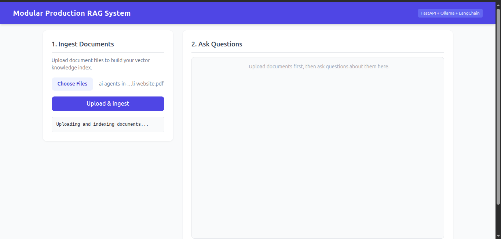
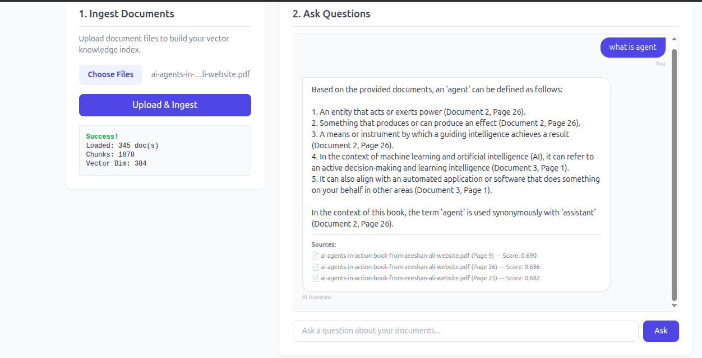

# 🚀 Modular Agentic RAG Pipeline

[](https://www.python.org/)
[](https://fastapi.tiangolo.com/)
[](https://www.langchain.com/)
[](https://github.com/facebookresearch/faiss)
[](https://ollama.ai/)
[](https://pytest.org/)

A modular, production-grade **Retrieval-Augmented Generation (RAG)** pipeline designed for enterprise document processing, contextual question answering, and adaptive vector search. Built with test-driven development (TDD), achieving **95%+ test coverage** across all pipeline modules.

---

## 🌟 Key Features

* **🧩 Modular Micro-Architecture:** Clean separation of concerns between `Loader`, `Chunker`, `EmbeddingService`, `VectorStore`, `Retriever`, and `GenerationService`.
* **⚡ High-Performance Vector Search:** L2-normalized cosine similarity index powered by **FAISS** with atomic disk persistence (`save`/`load`).
* **🔒 Hallucination Safeguards:** Strict system prompts with fallback triggers and exact citation tracking (file name, page numbers, and cosine relevance scores).
* **🌐 Web Dashboard & REST API:** Embedded FastAPI web client featuring interactive document ingestion and real-time Q&A chat.
* **🛡️ Production-Grade Quality:** Enforced Pydantic schema validation, robust exception wrappers, and exhaustive `pytest` integration suite.

---

## 🖼️ Interface & Workflow Showcase

| Document Ingestion Panel | Interactive Q&A Dashboard |
| :---: | :---: |
|  |  |
| *Multi-format file upload with real-time indexing status.* | *Contextual responses backed by source citations.* |

---

## 🏗️ System Architecture

```text
[ PDF / TXT Documents ]
          │
          ▼
    ┌───────────┐
    │  Loader   │ ──► Extracts text content & page metadata
    └─────┬─────┘
          │
          ▼
    ┌───────────┐
    │  Chunker  │ ──► Dynamic recursive chunking with overlap
    └─────┬─────┘
          │
          ▼
┌──────────────────┐
│ EmbeddingService │ ──► Sentence Transformers (e.g., all-MiniLM-L6-v2)
└────────┬─────────┘
         │
         ▼
 ┌──────────────┐
 │ VectorStore  │ ──► FAISS (L2 Normalization, Inner-Product)
 └───────┬──────┘
         │
         ▼
   ┌───────────┐
   │ Retriever │ ──► Similarity search + Threshold filtering
   └─────┬─────┘
         │
         ▼
┌──────────────────┐
│GenerationService │ ──► Ollama (Mistral / Llama 3) with grounded context
└────────┬─────────┘
         │
         ▼
  [ RAGResponse ] ──► Strict JSON contract with source attributions

----

🛠️ Quick Start Guide
 1. Prerequisites
Python 3.10+

Ollama installed and running locally with your desired model:
    ollama pull mistral

2. Installation
Clone the repository and set up your virtual environment:
git clone [https://github.com/inamullahcraker-cloud/modular-agentic-rag.git](https://github.com/inamullahcraker-cloud/modular-agentic-rag.git)
cd modular-agentic-rag

python3 -m venv jupyter_env
source jupyter_env/bin/activate
pip install -r requirements.txt

3. Running the Server & Web UI
Launch the application using Uvicorn:
uvicorn api:app --reload --port 8000

 📡 API Endpoints Summary
      Method                   Endpoint            Description                        Payload / Query

      POST                     /api/ingest       Uploads documents and triggers       multipart/form-data (files)
                                                     batch vector indexing.
                         
      POST                    /api/query           Queries knowledge base and returns    {"query": "...", "top_k": 3}
                                                       generated response

      GET                      /                   Serves the frontend web                   N/A
                                                    dashboard.

🧪 Testing & Code Coverage
This project strictly follows Test-Driven Development (TDD). Run the test suite with code coverage enabled:
PYTHONPATH=. pytest --cov=src --cov-report=term-missing -v
 Coverage Overview:
Name                                Stmts   Miss  Cover
-------------------------------------------------------
src/api.py                             59      2    97%
src/chunking.py                        57      3    95%
src/contracts.py                       27      0   100%
src/embedding_service.py               65      3    95%
src/generation.py                      55      1    98%
src/loader.py                          68      6    91%
src/rag_pipeline.py                    81      9    89%
src/retriever.py                       35      0   100%
src/vectordatabase.py                 137     10    93%
-------------------------------------------------------
TOTAL                                 798     39    95%

